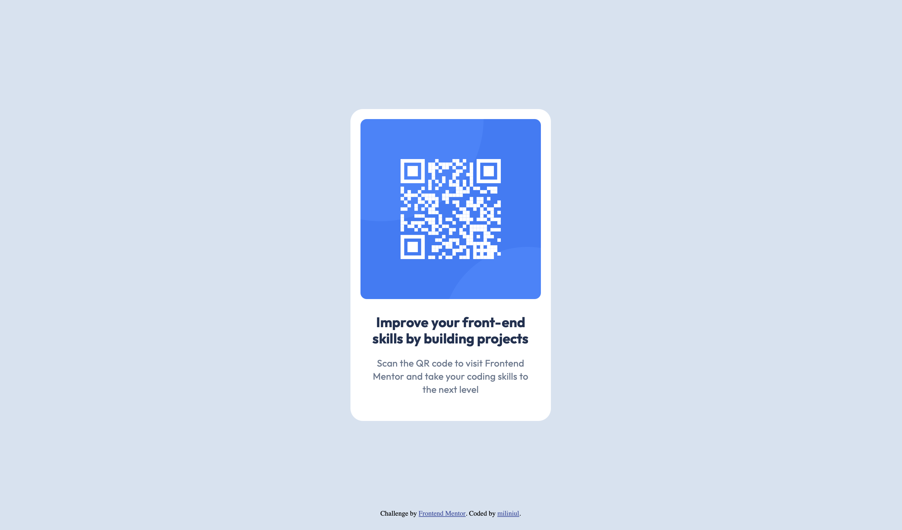

# Frontend Mentor - QR code component solution

This is a solution to the [QR code component challenge on Frontend Mentor](https://www.frontendmentor.io/challenges/qr-code-component-iux_sIO_H). Frontend Mentor challenges help you improve your coding skills by building realistic projects. 

## Table of contents

- [Overview](#overview)
  - [Screenshot](#screenshot)
  - [Links](#links)
- [My process](#my-process)
  - [Built with](#built-with)
  - [What I learned](#what-i-learned)
  - [Continued development](#continued-development)
  - [Useful resources](#useful-resources)
  - [AI Collaboration](#ai-collaboration)
- [Author](#author)

## Overview

### Screenshot




### Links

- Solution URL: (https://miliniul.github.io/qr-code/)

## My process

### Built with

- Semantic HTML5 markup
- CSS custom properties
- Flexbox
- CSS Grid
- Mobile-first workflow


### What I learned

While working on this project, I learned how to:

- Use CSS Grid to structure the page layout.
- Use Flexbox to align elements and control spacing between them.
- Add custom fonts using `@font-face` and specify the correct paths to font files.
- Keep the footer at the bottom of the page without overlapping the main content.
- Inspect elements in browser DevTools to understand margins and measure spacing.

I learned how to load a custom font using `@font-face` and reference the font file with a relative path.

```css
@font-face {
  font-family: "Outfit";
  src: url("./fonts/Outfit-Regular.ttf") format("truetype");
}

.text-container {
  font-family: "Outfit", sans-serif;
}
```

### Continued development

In future projects, I want to deepen my understanding of HTML and CSS, with a focus on semantic HTML, responsive design, and building layouts with Grid and Flexbox. I also want to become more confident in managing spacing and choosing the right layout approach for each task.

My next step is to start learning JavaScript so I can add interactivity to my pages. I plan to begin with the fundamentals, then practice working with the DOM and handling user events.

I also want to improve accessibility and write cleaner, more organized code as I build new projects.

### Useful resources

- [Doka](https://doka.guide/) — A community-driven resource in Russian with clear explanations and practical examples of HTML, CSS, and JavaScript. Useful for understanding layout techniques and reviewing the basics.
- [MDN Web Docs](https://developer.mozilla.org/en-US/) — Comprehensive documentation and guides for web technologies. A helpful reference for checking syntax, exploring CSS properties, and learning JavaScript.

### AI Collaboration

I used Perplexity to find learning resources and explore HTML and CSS concepts while working on this project. It helped me understand Grid and Flexbox, how to add custom fonts, and how to manage spacing between elements.

I used it as a learning aid, testing the suggestions in my project to better understand how they worked.

## Author

- Frontend Mentor - [@miliniul](https://www.frontendmentor.io/profile/miliniul)
